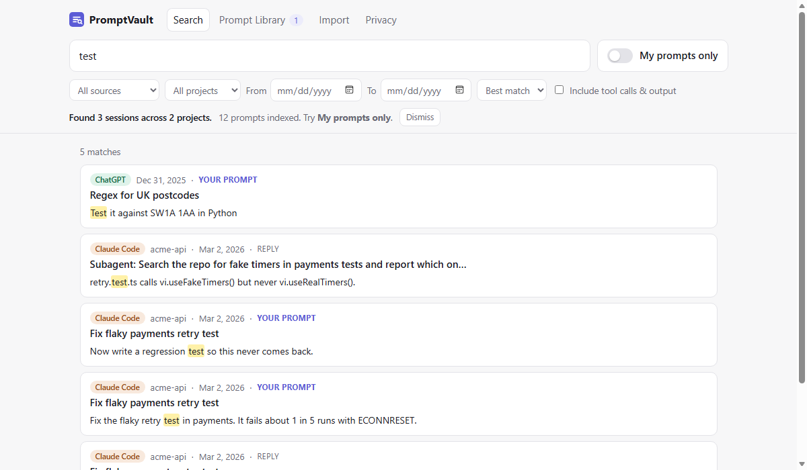

<div align="center">

# PromptVault

### Every prompt you've ever written to an AI, searchable in one place.<br>Runs on your machine. Nothing uploaded.

<!-- TODO before launch: record docs/hero.gif (see LAUNCH.md → "Recording the hero GIF") -->


```sh
npx promptvault
```

</div>

PromptVault finds every Claude Code session already on your disk, indexes it, and opens a search page in your browser. It shows *"Found 1,284 sessions across 37 projects."* Add your ChatGPT, Claude.ai, and Gemini exports, and one search box covers all of them.

- **My prompts only.** One switch to search only what *you* typed, without tool output and AI replies cluttering the results. Find the prompt that worked six weeks ago, in any tool.
- **Every source in one box.** Filter by tool, project/repo, and date. Matches are highlighted.
- **A clean session reader.** Tool calls fold away, and each of your prompts has a Copy button.
- **Prompt Library.** Star the prompts worth reusing, then export them (or any session) to Markdown.
- **`--watch`.** New Claude Code sessions are searchable seconds after they're written.
- **Built for big histories.** 10,000 sessions plus a 300 MB transcript index in about 30 seconds, and the page stays responsive while that happens.
- **Free and MIT.** No account, no paid tier, no telemetry. No dependencies besides Node.

## Install

You need **Node.js 22.23+ or 24+** (Node 23 is not supported) ([nodejs.org](https://nodejs.org)). Works on Windows, macOS, and Linux.

```sh
npx promptvault            # index + open the search page
npx promptvault --watch    # ...and keep indexing new sessions
```

Or install it once and run it offline from then on: `npm i -g promptvault`, then `promptvault`.

## Supported sources

| Source | How | Setup |
|---|---|---|
| **Claude Code** (CLI, IDE, desktop app's Code tab) | Read from `~/.claude/projects` | None, found automatically |
| **ChatGPT** | Official export | Settings → Data controls → Export data |
| **Claude.ai / Claude desktop chats** | Official export | Settings → Privacy → Export data |
| **Gemini** | Google Takeout | My Activity → Gemini Apps, **JSON** format |
| Codex CLI, Cursor | Not yet | [Formats documented](FORMATS.md). [Add a source in 30 minutes](CONTRIBUTING.md#add-a-new-source-in-30-minutes) |

Import an export by **dragging the .zip onto the page**, or from the terminal:

```sh
npx promptvault import ~/Downloads/chatgpt-export.zip
npx promptvault import ~/Downloads/takeout-20261024.zip
```

Zips are read in place, with no unzipping needed. PromptVault detects which tool each file came from.

## Privacy

PromptVault is a program on your computer. It is not a service.

**It makes zero network calls.** No telemetry, no analytics, no crash reports, no update checks, no fonts or scripts from a CDN. The search page is served by PromptVault itself on `127.0.0.1` (your own machine, not reachable from other computers), and its security policy forbids it from loading anything from anywhere else.

**What it reads** (and never modifies):
- `~/.claude/projects/**/*.jsonl` (also `$CLAUDE_CONFIG_DIR/projects` if you set that). Run `npx promptvault where` to see the exact folders.
- Export files you import yourself.
- It never reads `~/.claude/.credentials.json`, your settings, or anything else.

**What it writes:** one SQLite database, plus copies of exports you drag into the page:

| OS | Location |
|---|---|
| Windows | `%LOCALAPPDATA%\promptvault\` |
| macOS | `~/Library/Application Support/promptvault/` |
| Linux | `$XDG_DATA_HOME/promptvault/` (default `~/.local/share/promptvault/`) |

**Delete everything** with `npx promptvault wipe`, or Privacy → *Wipe index* on the page. Your original AI history is not touched.

### Verify it yourself

You don't have to take this README's word for it.

1. **Read the code.** It's about 2,300 lines (UI included) with **no dependencies** (`package.json` → `"dependencies": {}`), so there is nothing hidden in `node_modules`. Search it: `grep -rnE "https?://|fetch\(|require\('https|node:(https|net|dns|tls)" src bin public`. The only hits are `127.0.0.1`/`localhost` addresses, the page's one `fetch()` to its own server, the standard SVG namespace string, and the GitHub links in the page footer.
2. **Watch its connections while it runs.**
   - macOS/Linux: `lsof -i -a -p $(pgrep -f promptvault)`
   - Windows (PowerShell): `Get-NetTCPConnection -OwningProcess (Get-Process node).Id`

   You'll see one `LISTEN` socket on `127.0.0.1` and nothing else.
3. **Pull the plug.** Install it once (`npm i -g promptvault`), turn off Wi-Fi, and run `promptvault`. Everything works. (`npx` itself contacts the npm registry to *download* the package. That's npm, not PromptVault.)
4. **Open DevTools → Network** on the search page. Every request goes to `127.0.0.1`.
5. The test suite includes `test/no-network.test.js`, which fails the build if outgoing network code is ever added.

## Commands

```text
promptvault                       Index Claude Code history, open the search UI
promptvault --watch               ...and keep indexing new sessions as they are written
promptvault import <file|dir>     Import a ChatGPT / Claude / Gemini export (.zip, .json, or folder)
promptvault search <words>        Search from the terminal (--prompts for your prompts only)
promptvault index                 Index only, print a summary
promptvault export --library      Prompt Library as Markdown (-o file.md to save)
promptvault export --session <id> One session as Markdown
promptvault wipe                  Delete the local database and imported copies
promptvault where                 Show which files are read and where the index lives

--port <n>  --no-open  --db <file>  --claude-dir <dir>  --import <path>
```

In the page, press `/` to jump to the search box and `Alt+P` to toggle **My prompts only**. Search tips: every word is prefix-matched (`deplo` finds *deploy*), and `"quoted phrases"` match exactly.

## FAQ

**Does it work with Claude Code on another machine / WSL?** Point it at the folder: `promptvault --claude-dir /mnt/c/Users/me/.claude`.

**Why is the index big?** Tool output (test logs, file reads) is indexed so you can find "that error from last month", capped at 8 KB per tool result. Expect an index of roughly 25–75% of your history's size (25% on a real Claude Code history, 75% on a tool-output-heavy synthetic one).

**Is my data safe if I visit a malicious website while PromptVault runs?** The local server only answers requests addressed to `127.0.0.1`/`localhost` (which blocks DNS-rebinding), and it refuses any change unless the request carries a header that other websites can't add. See `test/server.test.js`.

**What happened to "thinking" blocks?** Claude Code stores them redacted on disk, and ChatGPT's reasoning is skipped too. Only what was visible in the conversation is indexed.

## Contributing

The most valuable contribution is **a new source**. Each source is one file with two functions, and [CONTRIBUTING.md](CONTRIBUTING.md) walks you through it in 30 minutes, fixture template included. Wanted: Codex CLI, Cursor, Cowork, Copilot Chat, Aider, Windsurf, Zed, Continue, Perplexity, Grok, Mistral Le Chat.

## Maintainer notes

Launch plan, post drafts, and success criteria are in [LAUNCH.md](LAUNCH.md). Design decisions, explained for non-coders, are in [DECISIONS.md](DECISIONS.md). What's deliberately not built is in [BACKLOG.md](BACKLOG.md).

---

<div align="center">

MIT licensed · Made by [YOUR_NAME](https://github.com/YOUR_GITHUB_USERNAME) · [Sponsor on GitHub](https://github.com/sponsors/YOUR_GITHUB_USERNAME)

</div>
